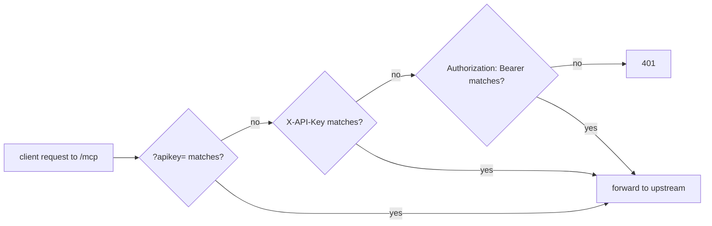

# v1.9.0 — API key in a header, not just the URL

## TL;DR

`serve` and `daemon` now accept the `MCP_APIKEY` key in any of three places, the same three `mcpproxy-go` accepts:

| where | example |
|---|---|
| query parameter (unchanged) | `/mcp?apikey=KEY` |
| `X-API-Key` header | `X-API-Key: KEY` |
| `Authorization` header, Bearer scheme | `Authorization: Bearer KEY` |

## Why

Some MCP clients cannot put a secret in the URL. claude.ai custom connectors, for example, take a server URL plus custom headers. Against v1.8.0 those clients got `401 Unauthorized: invalid or missing apikey` no matter which header they sent, because the shim only read `?apikey=`. Pointing the same client straight at `mcpproxy-go` worked, which made the shim look broken.

A header also keeps the key out of URLs, which tend to end up in access logs and browser history.

## Highlights

| change | detail |
|---|---|
| header auth | `X-API-Key: KEY` or `Authorization: Bearer KEY` (scheme is case-insensitive) |
| constant-time compare | keys are compared with `crypto.timingSafeEqual` instead of `!==` |
| stricter than it looks | `Authorization: KEY` without `Bearer` is still rejected, matching `mcpproxy-go` |
| startup log | `Auth: apikey required (?apikey=, X-API-Key or Bearer)` |



## Before / after

```bash
# v1.8.0: 401, v1.9.0: 200
curl -X POST https://shim.example.com/mcp \
  -H 'X-API-Key: KEY' \
  -H 'Content-Type: application/json' \
  -H 'Accept: application/json, text/event-stream' \
  -d '{"jsonrpc":"2.0","id":1,"method":"initialize","params":{"protocolVersion":"2025-03-26","capabilities":{},"clientInfo":{"name":"t","version":"1"}}}'
```

## Upgrade notes

No config change. Existing `?apikey=` clients keep working. Unset `MCP_APIKEY` still means no auth.

## Files changed

- `src/core.ts`: new `hasValidApiKey()`
- `src/http-server.ts`, `src/daemon.ts`: use it in the `/mcp` gate
- `src/index.ts`, `README.md`: document the header forms
